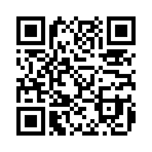
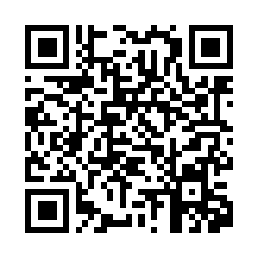
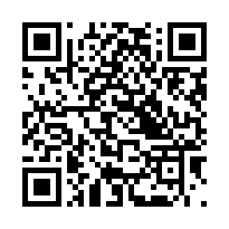

# Support CUSTOS · Поддержать CUSTOS

<!--
  To add a wallet: copy one of the sections below, change the network, the coins and the address, and put a QR code of
  the plain address (nothing but the address inside) into docs/donate/. Keep the network next to every address.
-->

CUSTOS is free software and stays free. If it saves your data or your time, you can support its development with a
donation in cryptocurrency. Any amount helps, and thank you!

CUSTOS — бесплатная программа и такой останется. Если она бережёт ваши данные или время, можно поддержать её развитие
переводом в криптовалюте. Любая сумма помогает, спасибо!

> [!WARNING]
> **Send each coin only in the network named next to its address.** A transfer made in another network may be lost.
>
> **Отправляйте монеты только в той сети, что указана рядом с адресом.** Перевод в другой сети может потеряться.

The only real addresses are the ones on this page in the
[openpass1/custos](https://github.com/openpass1/custos/blob/main/DONATE.md) repository. If a copy of the program or of
this page shows other addresses, do not send anything to them.

Настоящие адреса — только те, что на этой странице в репозитории
[openpass1/custos](https://github.com/openpass1/custos/blob/main/DONATE.md). Если копия программы или этой страницы
показывает другие адреса, ничего на них не отправляйте.

## BNB Smart Chain (BEP-20)

```
0x46C45A728dcee4F7D0E322e095F898F38a2443A3
```



- **Network: BNB Smart Chain (BEP-20) only.** Not Ethereum or any other network, even if your wallet accepts the
  address there. Coins: BNB, USDT (BEP-20), USDC (BEP-20).
- **Сеть: только BNB Smart Chain (BEP-20).** Не Ethereum и не другие сети, даже если кошелёк принимает там этот адрес.
  Монеты: BNB, USDT (BEP-20), USDC (BEP-20).

## Solana

```
GpQsyVUpGPoyKYJpVsyDp8HLzWpgEBgcDpuqWuD4oUn1
```



- **Network: Solana.** Coins: SOL, USDT and USDC on Solana (SPL).
- **Сеть: Solana.** Монеты: SOL, USDT и USDC в сети Solana (SPL).

## TON

```
UQDcblXbmGMoZ_qvWnnA4neXxx-1pMEkcGvA4ojv4kExRw8D
```



- **Network: TON (The Open Network).** Coins: Toncoin, USDT on TON.
- **Сеть: TON (The Open Network).** Монеты: Toncoin, USDT в сети TON.

## Other ways to help · Другие способы помочь

- Star the repository, tell colleagues about CUSTOS, report bugs and ideas in
  [Issues](https://github.com/openpass1/custos/issues).
- Поставьте звезду репозиторию, расскажите о CUSTOS коллегам, пишите об ошибках и идеях в
  [Issues](https://github.com/openpass1/custos/issues).

A donation is a thank-you: it does not buy support or features, and the program is the same for everyone.

Перевод — это благодарность: он не покупает поддержку или новые возможности, программа одна для всех.
