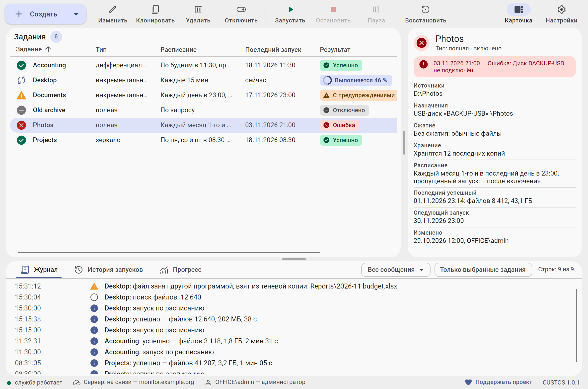
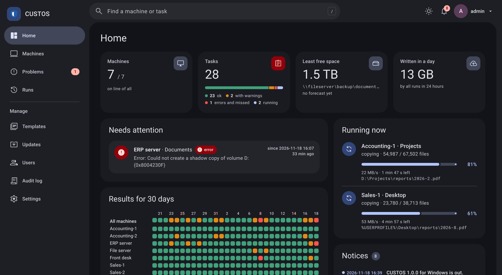

# CUSTOS

Backup agents for Windows, macOS and Linux servers, with a self-hosted monitoring site. On Windows, CUSTOS is a free replacement for Cobian Backup 11.

[Русская версия](README.ru.md)

The agents make backups on each machine. CUSTOS Monitor shows their progress in one place, sends alerts and lets you
manage tasks remotely. Windows and macOS can be set up locally. The headless Linux agent uses Monitor to configure
its backup tasks.

## Choose what to install

| Component | Runs on | Download | Guide |
|---|---|---|---|
| Windows agent | Windows 10 and 11, Windows Server 2019, 2022 and 2025 (x64) | [Releases](https://github.com/openpass1/custos/releases) · `CUSTOS-Setup-<version>.exe` | [Windows](client/README.md#windows) |
| Windows legacy | Windows 7 SP1 and 8.1 (32-bit build) | [Preview release](https://github.com/openpass1/custos/releases/tag/client-legacy-v1.0.1) · `CUSTOS-Legacy-Setup-<version>.exe` | [Legacy edition](client/README.md#edition-for-windows-7-and-81) |
| macOS agent | macOS 15+ (Apple silicon or Intel) | [Preview release](https://github.com/openpass1/custos/releases/tag/client-v1.2.0) · `Custos-<version>.pkg` | [macOS](client/README.md#macos) |
| Headless Linux agent | Linux servers with systemd and glibc 2.28+ (x86_64 or ARM64) | [Releases](https://github.com/openpass1/custos/releases) · `custos-linux-x64.tar.gz` or `custos-linux-arm64.tar.gz` | [Linux agent](client/README.md#custos-for-linux) |
| CUSTOS Monitor | Linux with nginx, PHP 8.3+, MariaDB 10.11+ or MySQL 8.0+ | [Releases](https://github.com/openpass1/custos/releases) · `custos-server-<version>.zip` | [Install and update](server/INSTALL.en.md) |

In a release, open **Assets** and choose the installer or archive for your platform. The agent update ZIPs are for
the **Updates** page in Monitor. You can download previews manually or select the **Preview** GitHub release channel in Monitor 1.4.3 or later.

A graphical Linux desktop client is planned. There is no installer or announced release date for it yet.
The [custos-helper](helper/README.md) script is a separate tool that lets a CUSTOS agent read files and database dumps
from a Linux server over SSH.

## Quick start

- **Windows:** run the installer and [set up your first backup](client/README.md#windows). To connect to Monitor,
  copy the connection string from its **Install** page, then paste it under **Settings → Monitoring server** in the
  program. Approve the machine in Monitor under **Machines**.
- **Windows legacy and macOS:** use the platform guides in the table for the system requirements and installation steps.
- **Linux server:** with CUSTOS Monitor 1.4.1 or newer, add the `custos-linux-<version>.zip` package on **Updates**,
  copy the Linux command from **Install**, run it on the Linux machine and approve the machine under **Machines**.
  [Linux installation and commands](client/README.md#custos-for-linux)
- **Monitor:** follow the guide for [CloudPanel](server/INSTALL.en.md) or [plain Debian or Ubuntu](server/INSTALL.en.md#debian-and-ubuntu-one-command).
  The [update section](server/INSTALL.en.md#updating) covers the web UI and offline upgrades.

## CUSTOS for Windows

- Full, incremental, differential and mirror backups (exact, or safe with deleted files kept for a while). Schedules
  by day, week, month or timer; a run missed while the computer was off is made after it starts.
- Writes straight to the destination, without a temporary copy on the local disk. Destinations: a local folder, a
  network share with its own account, a USB disk found by its volume label, SFTP, FTP and FTPS, WebDAV, S3 (with
  Object Lock against deletion), Google Drive, Yandex Disk and Dropbox. One task can write to several destinations at
  once.
- Google Drive works in the released program as it is. For Yandex Disk and Dropbox, register a free application of
  your own with the service and enter it under Settings → Cloud drives → Own applications…
  ([steps](client/README.md#custos-applications-at-the-services)).
- 7z or ZIP archives with AES-256 encryption, 7z volumes, verification of new and stored copies.
- Retention by count, by age or grandfather-father-son (GFS). A set is deleted only as a whole, never after a failed
  run, and the last good full copy is always kept.
- Open files through VSS, NTFS permissions, low priority so that the computer stays usable during a backup.
- Database dumps: MySQL, MariaDB and PostgreSQL, OSPanel included.
- Linux servers: files and database dumps are pulled over SSH through the read-only script
  [custos-helper](helper/README.md).
- Restore to a date, moving tasks to another computer (export to a file and import, passwords encrypted if wanted),
  import of tasks from Cobian Backup 11.
- A program password and a limited interface for users who are not administrators (state only, or hidden); actions on
  several tasks at once.
- Russian and English, light and dark theme.

## CUSTOS Monitor

- Notices not only failed backups but also the ones that never happened: a disabled task, a hung service, a computer
  that was switched off.
- Dashboard with live progress, a 30-day heat map, run history with logs, free space of the storages with a forecast.
- Alerts in Telegram and by e-mail, a Zabbix template, a wall screen for a TV.
- Remote control: run and stop tasks, edit them, apply templates to groups of computers, update the program and 7-Zip.
- A computer is approved on the site by its key fingerprint; every request and answer is signed.
- Search of machines and tasks; Russian and English, light and dark theme, works on a phone.

## Documentation

| Document | What is in it |
|---|---|
| Agent guides | [Windows](client/README.md#windows), [legacy](client/README.md#edition-for-windows-7-and-81), [macOS](client/README.md#macos), [Linux](client/README.md#custos-for-linux). Backups, destinations, updates, task migration and development. |
| [server/INSTALL.en.md](server/INSTALL.en.md), [server/INSTALL.md](server/INSTALL.md) | Installing and updating the site on CloudPanel or plain nginx, Telegram, e-mail, Zabbix |
| [server/README.md](server/README.md) | How the site is built, tests, the fake agent |
| [helper/README.md](helper/README.md) | Using custos-helper to read backups over SSH (in Russian) |
| [docs/](docs/) | Specifications (in Russian) and the [protocol](docs/protocol.md) between the program and the site |

## Checking a download

Every release has `SHA256SUMS.txt`. On Windows, compare it with the output of
`certutil -hashfile CUSTOS-Setup-<version>.exe SHA256`; on Linux run `sha256sum -c --ignore-missing SHA256SUMS.txt` in the folder with
the files. The Windows files are not code-signed yet: the project has applied for free code signing by SignPath
Foundation, see the [code signing policy](CODE_SIGNING.md).

## Code signing policy and privacy

The project has applied for free Windows code signing through [SignPath Foundation](https://signpath.org/).
See the [code signing policy](CODE_SIGNING.md) for the status and signing process.

CUSTOS has no telemetry and sends nothing to its authors. The only connection that you do not set up yourself is a
daily question to GitHub about a new version, and it can be turned off: [PRIVACY.md](PRIVACY.md).

## Feedback and security

Bugs and ideas: [Issues](https://github.com/openpass1/custos/issues), in English or Russian. Please report security
problems privately, as described in [SECURITY.md](SECURITY.md).

## Support the project

CUSTOS is free. If it is useful to you, you can support its development with a donation in cryptocurrency:
the wallets, their networks and QR codes are in [DONATE.md](DONATE.md).

## License

CUSTOS is free software under the [GNU General Public License v3.0](LICENSE). It ships with third-party components
under their own licenses: [client/THIRD-PARTY-NOTICES.txt](client/THIRD-PARTY-NOTICES.txt),
[server/THIRD-PARTY-NOTICES.txt](server/THIRD-PARTY-NOTICES.txt). 7-Zip (`7z.dll`) is licensed under the GNU LGPL.

CUSTOS comes **without any warranty**, to the extent permitted by law: it is provided "as is", and its authors are not
liable for any damage from using it, including lost data (sections 15 and 16 of the license). Check your backups by
restoring them now and then.
