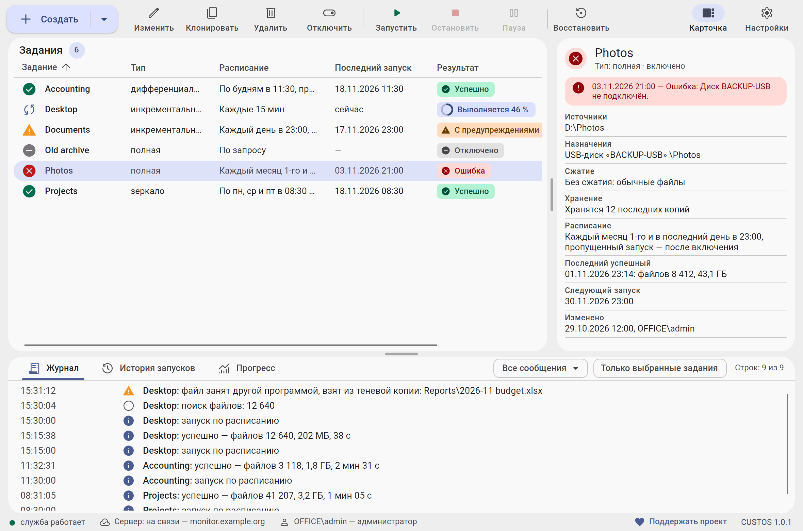
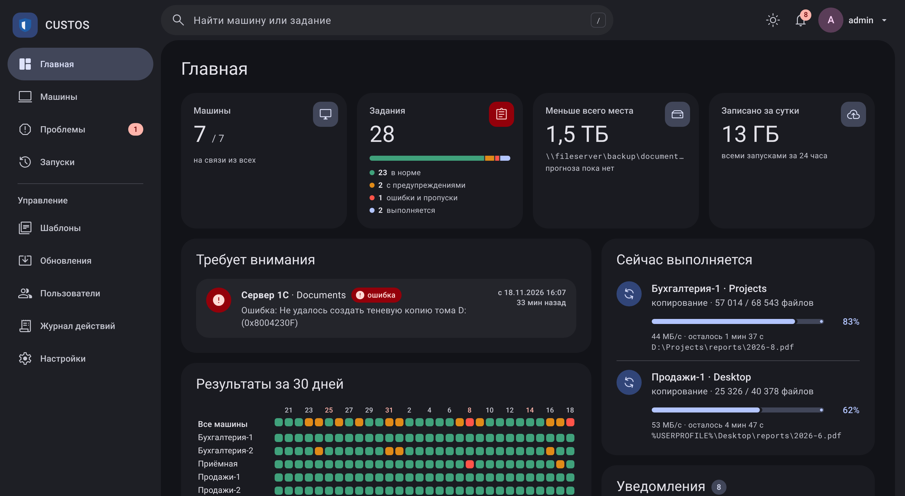

# CUSTOS

Резервное копирование компьютеров с Windows с централизованным мониторингом. Бесплатная замена Cobian Backup 11.

[English version](README.md)

[](https://github.com/openpass1/custos/releases)
[](https://github.com/openpass1/custos/releases)
[](https://github.com/openpass1/custos/actions/workflows/build.yml)
[](https://github.com/openpass1/custos/actions/workflows/server.yml)
[](LICENSE)

CUSTOS состоит из двух частей. Программа для Windows делает копии и работает сама по себе. Сайт мониторинга не
обязателен: он показывает все компьютеры в одном месте, предупреждает о проблемах и позволяет управлять заданиями
удалённо.

| | CUSTOS для Windows | CUSTOS Monitor |
|---|---|---|
| Что это | Программа резервного копирования: служба Windows и значок в трее | Сайт: сводка, уведомления, удалённое управление |
| Где работает | Windows 10 и 11, Windows Server 2019, 2022 и 2025 (x64) | Linux с nginx, PHP 8.3+, MariaDB 10.11+ или MySQL 8.0+ |
| Скачать | [Releases](https://github.com/openpass1/custos/releases), «CUSTOS for Windows»: `CUSTOS-Setup-<версия>.exe` | [Releases](https://github.com/openpass1/custos/releases), «CUSTOS Monitor»: `custos-server-<версия>.zip` |
| Инструкция | [client/README.ru.md](client/README.ru.md) | [server/INSTALL.md](server/INSTALL.md) |





## CUSTOS для Windows

- Полные, инкрементальные, дифференциальные копии и зеркало (точное или безопасное, где удалённые файлы хранятся
  ещё какое-то время). Расписание по дням, неделям, месяцам или по таймеру; запуск, пропущенный из-за выключенного
  компьютера, выполняется после включения.
- Пишет сразу в место назначения, без временной копии на локальном диске. Назначения: локальная папка, сетевая
  папка со своей учётной записью, USB-диск по метке тома, SFTP, FTP и FTPS, WebDAV, S3 (с защитой от удаления
  Object Lock), Google Диск, Яндекс Диск и Dropbox. Одно задание может писать в несколько назначений сразу.
- Google Диск работает в выпущенной программе сразу. Для Яндекс Диска и Dropbox зарегистрируйте у сервиса своё
  бесплатное приложение и впишите его в «Настройки» → «Облачные диски» → «Свои приложения…»
  ([по шагам](client/README.ru.md#приложения-custos-у-сервисов)).
- Архивы 7z и ZIP с шифрованием AES-256, тома 7z, проверка новых и хранящихся копий.
- Хранение по количеству, по возрасту или по схеме «дед-отец-сын» (GFS). Набор удаляется только целиком, никогда
  после неудачного запуска, а последняя удачная полная копия остаётся всегда.
- Открытые файлы через VSS, права NTFS, низкий приоритет, чтобы на компьютере можно было работать во время копии.
- Дампы баз данных: MySQL, MariaDB и PostgreSQL, в том числе в OSPanel.
- Linux-серверы: файлы и дампы баз забираются по SSH через скрипт только для чтения
  [custos-helper](helper/README.md).
- Восстановление на дату, перенос заданий на другой компьютер (экспорт в файл и импорт, пароли по желанию в
  зашифрованном виде), импорт заданий из Cobian Backup 11.
- Пароль программы и урезанный интерфейс для пользователей, которые не администраторы (только состояние или скрыт);
  действия сразу над несколькими заданиями.
- Русский и английский язык, светлая и тёмная тема.

## CUSTOS Monitor

- Замечает не только упавшие копии, но и те, что вообще не случились: задание отключили, служба зависла, компьютер
  был выключен.
- Сводка с ходом выполнения в реальном времени, карта результатов за 30 дней, история запусков с журналами, место в
  хранилищах с прогнозом.
- Уведомления в Telegram и на почту, шаблон для Zabbix, экран для телевизора.
- Удалённое управление: запуск и остановка заданий, их редактирование, шаблоны для групп компьютеров, обновление
  программы и 7-Zip.
- Компьютер подтверждается на сайте по отпечатку ключа; каждый запрос и ответ подписаны.
- Русский и английский язык, светлая и тёмная тема, работает на телефоне.

## Быстрый старт

1. **Сайт (по желанию).** На чистом сервере Debian 12 или 13, Ubuntu 24.04 или 26.04, от root (в Ubuntu перед `bash` добавьте `sudo`):
   ```bash
   wget https://raw.githubusercontent.com/openpass1/custos/main/server/install.sh
   bash install.sh
   ```
   Скрипт ставит nginx, MariaDB и PHP, настраивает сайт и cron и в конце печатает строку подключения.
   `bash install.sh --help` покажет его параметры; `bash install.sh --update` потом обновит сайт. Для CloudPanel
   есть пошаговая инструкция [server/INSTALL.md](server/INSTALL.md).
2. **Программа.** Запустите `CUSTOS-Setup-<версия>.exe` на каждом компьютере с Windows.
3. **Подключить компьютер к сайту.** На сайте: «Настройки» → «Подключение агентов» → скопировать строку
   подключения. В программе: «Настройки» → «Сервер мониторинга» → вставить её и нажать «Подключить». Затем
   подтвердить компьютер на сайте (раздел «Машины»).

## Документация

| Документ | Что в нём |
|---|---|
| [client/README.ru.md](client/README.ru.md) | Сборка клиента; базы данных, Linux-серверы, назначения на серверах, облачные диски, обновления, перенос заданий и переход с Cobian Backup, файлы на компьютере |
| [server/INSTALL.md](server/INSTALL.md), [server/INSTALL.en.md](server/INSTALL.en.md) | Установка и обновление сайта на CloudPanel или на чистом nginx, Telegram, почта, Zabbix |
| [server/README.md](server/README.md) | Устройство сайта, тесты, имитатор агента (на английском) |
| [helper/README.md](helper/README.md) | custos-helper на Linux-серверах |
| [docs/](docs/) | Технические задания и [протокол](docs/protocol.md) между программой и сайтом |

## Проверка скачанного файла

В каждом выпуске есть `SHA256SUMS.txt`. В Windows сравните его с тем, что выведет
`certutil -hashfile CUSTOS-Setup-<версия>.exe SHA256`; в Linux выполните `sha256sum -c SHA256SUMS.txt` в папке с
файлами. Файлы для Windows пока не подписаны цифровой подписью, подпись запланирована.

## Ошибки, идеи и безопасность

Ошибки и предложения: [Issues](https://github.com/openpass1/custos/issues), по-русски или по-английски. Об уязвимостях
пишите не публично, как описано в [SECURITY.md](SECURITY.md).

## Поддержать проект

CUSTOS бесплатна. Если она вам полезна, можно поддержать её развитие переводом в криптовалюте: кошельки,
их сети и QR-коды — в [DONATE.md](DONATE.md).

## Лицензия

CUSTOS — свободная программа под лицензией [GNU General Public License v3.0](LICENSE). В комплекте есть сторонние
компоненты под своими лицензиями: [client/THIRD-PARTY-NOTICES.txt](client/THIRD-PARTY-NOTICES.txt),
[server/THIRD-PARTY-NOTICES.txt](server/THIRD-PARTY-NOTICES.txt). 7-Zip (`7z.dll`) распространяется по лицензии GNU LGPL.

CUSTOS поставляется **без каких-либо гарантий** в той мере, в какой это допускает закон: программа даётся «как есть», и
её авторы не отвечают за ущерб от её использования, в том числе за потерю данных (разделы 15 и 16 лицензии). Время от
времени проверяйте копии, восстанавливая их.
