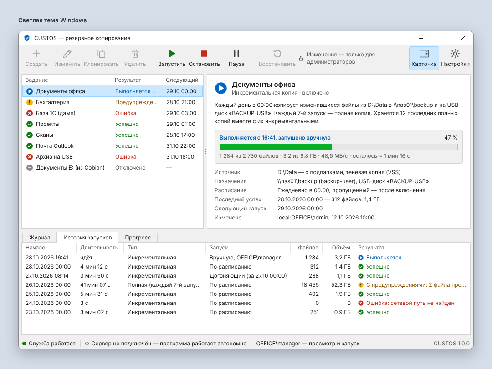
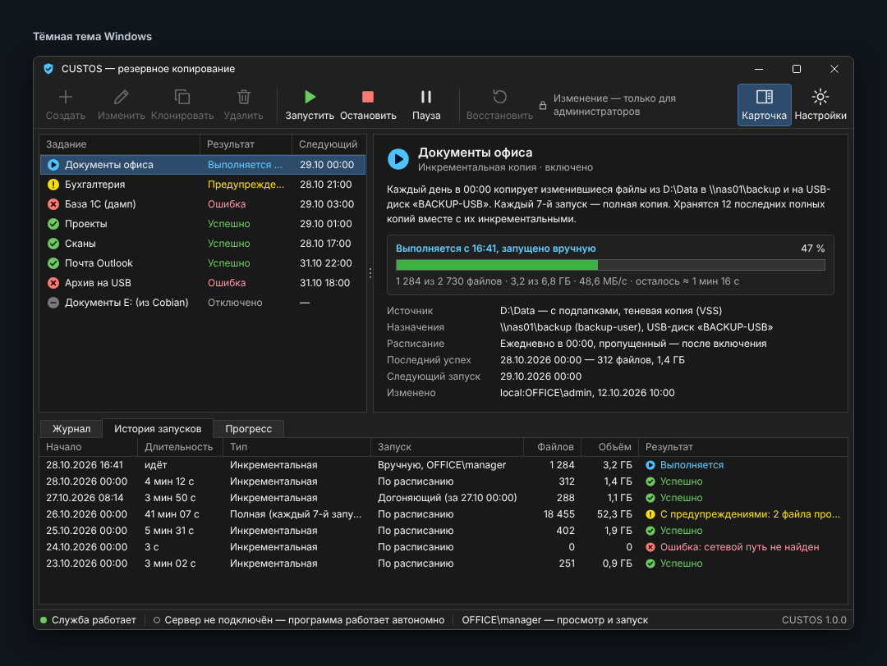
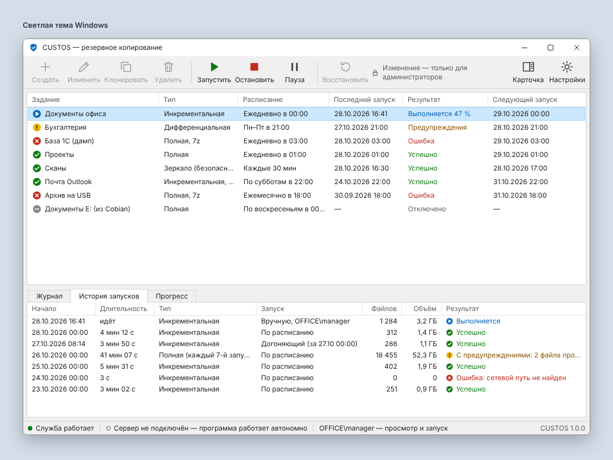
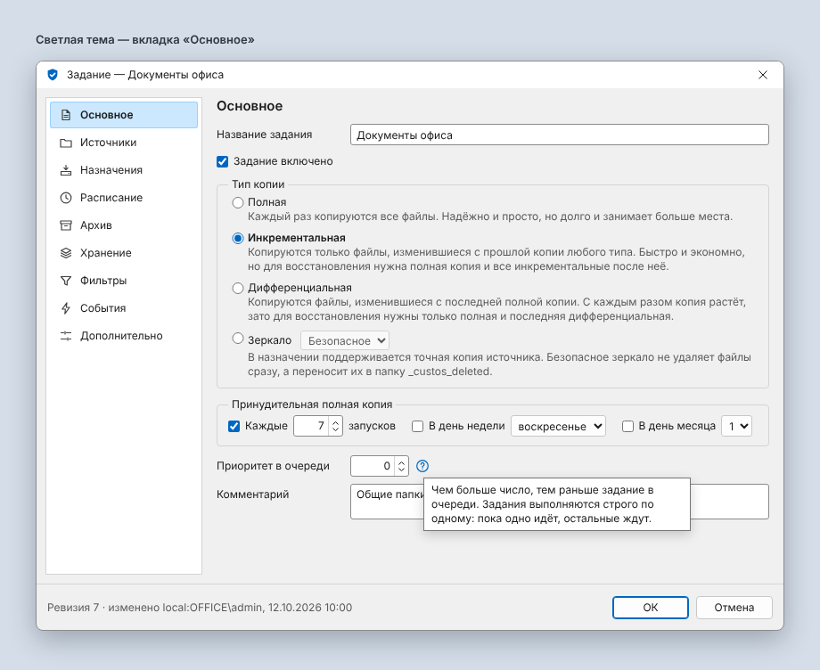
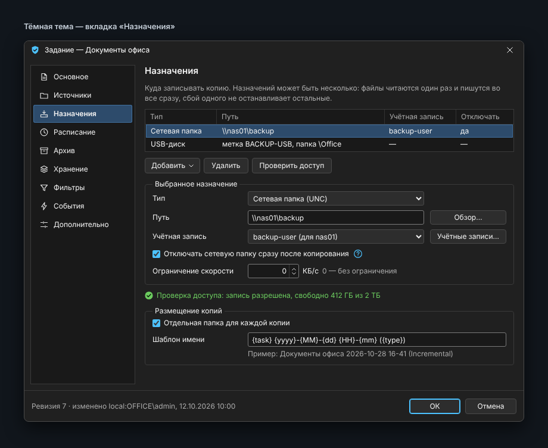
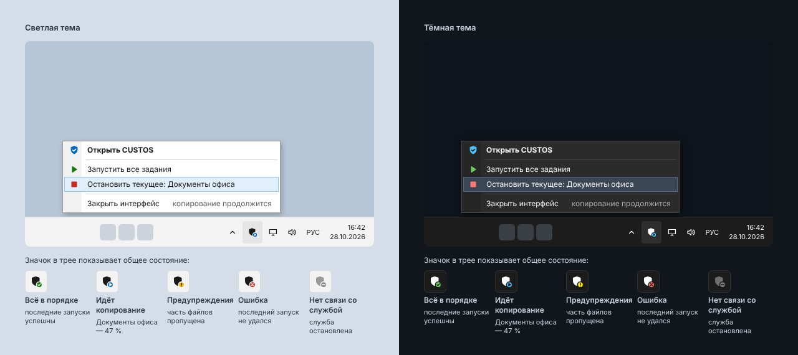

# CUSTOS — интерфейс клиента для Windows

Версия 1.0 от 28.10.2026. Дополняет раздел 5 [`CUSTOS-client.md`](CUSTOS-client.md): там сказано, что должно быть в интерфейсе, здесь — как это выглядит и как себя ведёт. Если документы расходятся, верен `CUSTOS-client.md`, а этот файл нужно поправить.

Картинки ниже — эскизы, а не снимки готовой программы. В настоящей программе рамки, кнопки и шрифты будут системные, а на Windows 10 и Server 2019 углы окон прямые. Все имена, пути и адреса на картинках вымышленные.

## 1. Общие правила

- **Только штатные элементы WinForms** (.NET 10): `ToolStrip`, `ListView` в режиме таблицы, `SplitContainer`, `TabControl`, `StatusStrip`, `GroupBox`, `TextBox`, `ComboBox`, `CheckBox`, `RadioButton`, `NumericUpDown`, `ToolTip`, `ContextMenuStrip`, `NotifyIcon`. Формы пишутся кодом, без визуального дизайнера. Ничего такого, что WinForms не умеет без сторонних библиотек.
- **Шрифт** — системный по умолчанию (Segoe UI 9 пт). Программа учитывает масштаб экрана (режим `PerMonitorV2`): на 125–200 % всё растёт пропорционально, без размытия.
- **Тема** — светлая или тёмная, по умолчанию как в Windows (`Application.SetColorMode`). Обе темы показаны на всех картинках.
- **Значки** — свой одноцветный набор 16 и 24 пикселя (и версии для 150 % и 200 %), перекрашивается под тему. Цветные только «Запустить» (зелёный) и «Остановить» (красный).
- **Цвет состояния всегда дублируется значком**, чтобы его различал и человек, плохо различающий цвета:

| Значок | Состояние | Где встречается |
|---|---|---|
| зелёный круг с галочкой | Успешно | список, история, значок в трее |
| жёлтый круг с «!» | С предупреждениями | список, история, журнал, трей |
| красный круг с крестиком | Ошибка | список, история, журнал, трей |
| синий круг с треугольником | Выполняется | список, история, трей |
| серый круг с чертой | Отключено / нет связи со службой | список, трей |

## 2. Главное окно

Выбран вариант «список и карточка»: слева задания, справа подробности выбранного задания.

Сверху вниз: панель кнопок, список заданий и карточка, вкладки «Журнал», «История запусков», «Прогресс», строка состояния. Размер окна по умолчанию 1000 × 700 при масштабе 100 %.

### 2.1. Панель кнопок

Крупные кнопки 24 пикселя с подписью под значком (`ToolStripItemDisplayStyle.ImageAboveText`).

| Кнопка | Что делает | Кто может |
|---|---|---|
| Создать | Новое задание, открывает редактор | Администратор |
| Изменить | Открывает редактор выбранного задания | Администратор |
| Клонировать | Копия задания под новым именем, отключённая | Администратор |
| Удалить | Удаляет задание после подтверждения. Сами копии не трогает | Администратор |
| Запустить | Ставит выбранное задание в очередь | Все |
| Остановить | Останавливает выполняемое задание | Все |
| Пауза | Приостанавливает и продолжает выполняемое задание | Все |
| Восстановить | Окно восстановления (раздел 6.11 ТЗ) | Администратор |
| **Карточка** | Показывает и скрывает карточку задания, см. 2.3 | Все |
| Настройки | Окно настроек программы | Смотреть — все, менять — администратор |

«Карточка» и «Настройки» стоят справа на панели, рядом. Кто может что делать, решает служба (раздел 4 ТЗ), интерфейс только показывает это: у обычного пользователя кнопки изменения неактивны, а слева от «Карточки» серым написано «Изменение — только для администраторов» со значком замка. Подсказка у каждой кнопки повторяет подпись и горячую клавишу.

### 2.2. Список заданий

- Одна строка — одно задание, групп нет. В начале строки значок состояния (таблица в разделе 1).
- Колонки как в ТЗ: «Задание», «Тип», «Расписание», «Последний запуск», «Результат», «Следующий запуск». Их всегда шесть, с карточкой и без: если рядом с карточкой они не помещаются, у списка появляется горизонтальная прокрутка. Без карточки список занимает всю ширину окна.
- Сортировка щелчком по заголовку колонки. Двойной щелчок по заданию открывает редактор у администратора и карточку у остальных.
- У выполняемого задания в колонке «Результат» написано «Выполняется 47 %».

### 2.3. Карточка задания и граница между панелями

Карточка работает как область просмотра в проводнике Windows:

- **Включается и выключается кнопкой «Карточка»** на панели (`ToolStripButton` с `CheckOnClick`: нажата — карточка видна). Горячая клавиша **Alt+P**, как в проводнике. В настройки этот переключатель не прячется.
- **Границу между списком и карточкой можно перетаскивать мышью** (`SplitContainer`, вертикальная граница с точками-захватом посередине). Наименьшая ширина списка 340 пикселей, карточки — 280 (при 100 %).
- **Граница между верхней частью и вкладками снизу** тоже перетаскивается (второй `SplitContainer`, горизонтальный).
- **Программа запоминает** для каждого пользователя Windows отдельно: видна ли карточка, положения обеих границ, размер и положение окна, ширины колонок, открытую вкладку снизу. Хранится в `%APPDATA%\CUSTOS\ui.json`. Это личные настройки вида, а не настройки службы, поэтому прав администратора не требуют.

Что в карточке, сверху вниз:

1. Значок состояния, название задания, тип копии и «включено» или «отключено».
2. **Описание простыми словами**, собранное из настроек задания. Например: «Каждый день в 00:00 копирует изменившиеся файлы из D:\Data в \\nas01\backup и на USB-диск «BACKUP-USB». Каждый 7-й запуск — полная копия. Хранятся 12 последних полных копий вместе с их инкрементальными». Такое же описание показывает сайт мониторинга (раздел 7.6 `CUSTOS-monitor.md`), правила построения фраз общие.
3. **Блок прогресса**, только пока задание выполняется: как запущено, процент, полоса, файлы, объём, скорость, сколько осталось.
4. Строки «название — значение»: источник, назначения с учётными записями, расписание, последний успешный запуск, следующий запуск, кто и когда изменил задание последним (`updated_by`, `updated_at`).

Если не выбрано ни одно задание, в карточке написано «Выберите задание в списке».

### 2.4. Вкладки снизу

- **Журнал** — строки в реальном времени: время, значок, текст. Предупреждения жёлтым, ошибки красным. Показывает, что копируется, какие файлы не удались и почему задание не запустилось.
- **История запусков** выбранного задания: начало, длительность, тип, как запущено (по расписанию, вручную с именем пользователя, догоняющий за пропущенный слот), файлов, объём, результат.
- **Прогресс** — текущий файл, полоса, файлы, объём, скорость, прошло и осталось, состояние каждого назначения.

Прогресс показывается только в окне программы, всплывающих окон и уведомлений нет (раздел 5 ТЗ).

### 2.5. Строка состояния

Слева направо: состояние службы, связь с сервером мониторинга, текущий пользователь и его права, версия программы. Примеры:

- «Служба работает» — зелёная точка; «Служба не отвечает» — серая.
- «Сервер: на связи — custos.example.lan» — зелёная; «Нет связи с сервером 12 мин — 3 отчёта ждут отправки» — жёлтая; «Сервер не подключён — программа работает автономно» — пустой кружок.
- «OFFICE\admin — администратор» или «OFFICE\manager — просмотр и запуск».

## 3. Редактор задания

- Отдельное окно с заголовком «Задание — <название>», размер по умолчанию 840 × 640.
- **Страницы слева, как в Cobian**: Основное, Источники, Назначения, Расписание, Архив, Хранение, События, Дополнительно. Список со значками, справа содержимое выбранной страницы.
- **Фильтры** — на странице «Источники», под списком источников, отдельной страницы нет (решение 11.11.2026). Там «Пропускать файлы» (маски, по умолчанию `~$*; *.tmp; *.log`), «Пропускать папки» (по одной на строке, кнопка «Обзор…» добавляет папку, выбранную так же, как источник), галочки скрытых, системных и временных файлов и «Только файлы». Фильтры действуют на все источники задания.
- **Подсказки.** У типов копии пояснение написано прямо под вариантом (тексты из раздела 6.1 ТЗ). У остальных непонятных параметров значок «?»: при наведении появляется подсказка.
- **Внизу** слева ревизия и кто последним менял задание, справа кнопки «ОК» и «Отмена».
- Варианты, которые для задания недоступны, видны, но неактивны, и рядом сказано почему. Например, 7z для назначения FTP (раздел 6.5 ТЗ).
- На странице «Назначения» список назначений, под ним свойства выбранного и кнопка «Проверить доступ»: она пробует записать в назначение под указанной учётной записью и показывает свободное место.

## 4. Меню в трее и значок

Меню (`ContextMenuStrip`) по правому щелчку на значке:

1. **Открыть CUSTOS** — жирным, то же делает двойной щелчок по значку.
2. Запустить все задания.
3. Остановить текущее: <название задания> — активно, только пока что-то выполняется.
4. Закрыть интерфейс — справа серым «копирование продолжится»: закрывается только окно и значок, служба работает дальше.

Значок — щит, справа внизу метка состояния: всё в порядке, идёт копирование, есть предупреждения, есть ошибка, нет связи со службой (щит серый). Подсказка при наведении: «CUSTOS: <состояние>», например «CUSTOS: Документы офиса — 47 %».

## 5. Откуда это

Эскизы нарисованы 28.10.2026 в трёх вариантах: «классический, как Cobian», «список и карточка» и «плотный, с прогрессом в строке». Выбран второй, к нему добавлены отключаемая карточка и подвижная граница. Исходный холст с эскизами (все варианты, кнопки и вкладки на нём можно нажимать): https://claude.ai/artifact/7Ch84p7TxryqoxRh6ocEo1 — открывается только у владельца проекта.
